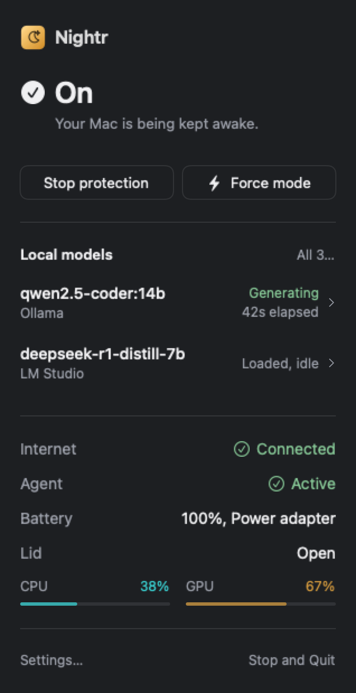
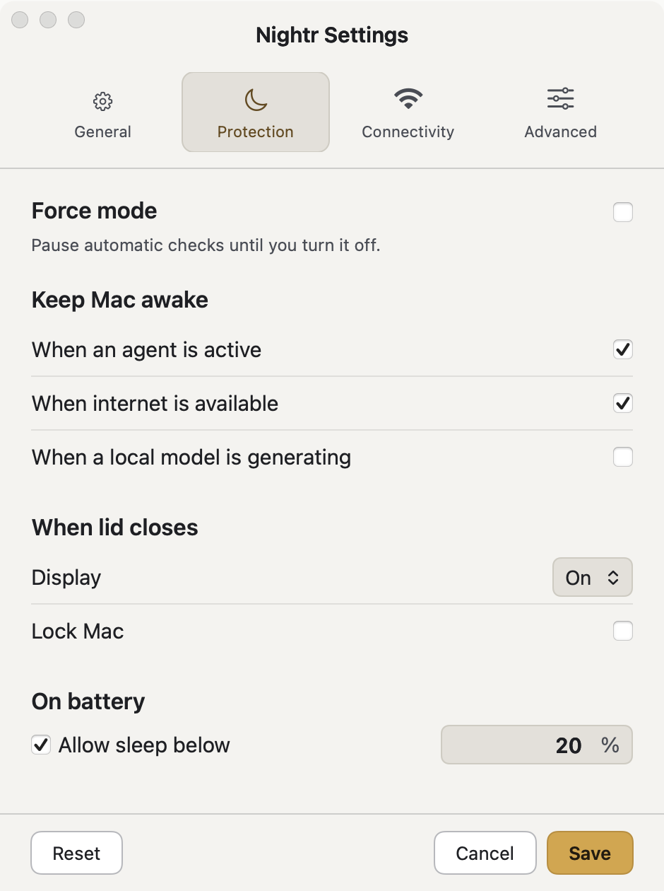

# Nightr

Nightr is a macOS menu bar app and CLI that keeps your Mac awake for coding
agents and local models. Set what happens when you close the lid, how much
battery to keep in reserve, and which hotspot to try if you lose internet access.
[nightr.ai](https://nightr.ai/)

<p>
  
  
</p>

## Install

For a direct install, open the signed DMG and run the included installer.
[GitHub Releases](https://github.com/agenthangar/nightr/releases)

To install with Homebrew, run the following command.

```sh
brew install --cask agenthangar/tap/nightr
```

Run `nightr setup` after installation to authorize the power helper. Use
`nightr setup --cli-only` for helper setup without a login app.

## Use Nightr

The menu bar app and CLI share preferences and protection status.

```sh
nightr config
nightr start
nightr status --json
nightr stop
```

- Choose when agent activity or internet access should keep your Mac awake.
  Local model generation can also keep it awake while offline. The menu shows
  model activity and CPU and GPU use when available. [Local model activity](docs/cli.md#local-model-activity)
- Pick a saved hotspot and set how many times Nightr should try it after an
  outage. Nightr verifies internet access separately from joining the hotspot.
  [Connectivity and other CLI settings](docs/cli.md)
- Stop applies to every client and persists across wake and login. Closed-lid
  protection requires exclusive control of the macOS sleep-disable setting
  during a Nightr session. [Power helper and installation details](docs/distribution.md)

Run `nightr` without a subcommand for foreground monitoring. Existing `nosleep`
commands, preferences, and Keychain entries carry over. Run `nightr update` to
update through your original installation method. [Update instructions](docs/distribution.md#package-ownership-and-updates)

## Agent controls

Run `nightr mcp` to give coding agents tools to inspect readiness, start or stop
protection, and manage hotspot recovery. Status tools are read-only. Protection
stays enabled or disabled when an agent disconnects or finishes a task.
[MCP and plugin setup](docs/plugins.md) and [command contract](docs/cli.md#mcp-server)

## Development

Contributor builds require a Swift toolchain and the macOS SDK. Run
`swift build` to compile native targets and `swift test` with XCTest. Linux CI
exercises portable logic. Native desktop tests are opt-in.

After `swift build --product nightr-native`, a protocol-only working preview is
available with `python3 scripts/preview_mcp.py --binary .build/debug/nightr-native`.
It shows native discovery and tool definitions, without invoking the controller
or machine operations. `python3 scripts/check_mcp.py --binary .build/debug/nightr-native`
runs the fake protocol harness and bounded stdio process checks.

```sh
python3 -m pip install -r requirements-dev.txt
python3 -m pytest --cov --cov-fail-under=97
```

Tests use temporary user state and mocked power/network/credential operations.
Never install helpers, alter power settings, join Wi-Fi or change Keychain as a
test on a developer's Mac. `design-preview/` is a separate browser simulation;
`site/` is the static product website.

Nightr was extracted from AgentHangar t. [Upstream attribution](docs/provenance.md)
and [implementation plan](docs/implementation-plan.md)
