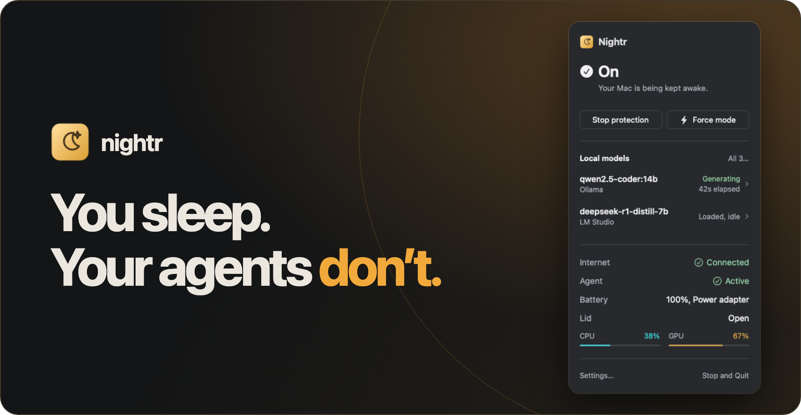

<h1 align="center">
  <a href="site/assets/screenshots/popover-on-dark.png"></a>
</h1>

<p align="center">Keep your Mac awake for coding agents and local models.</p>
<p align="center">
  <a href="#install"><strong>Install Nightr</strong></a>
  &nbsp; / &nbsp; <a href="https://nightr.ai/">Website</a>
  &nbsp; / &nbsp; <a href="docs/cli.md">CLI docs</a>
</p>

## Install

Open the signed DMG and run the included installer. [GitHub Releases](https://github.com/agenthangar/nightr/releases)

Or install with Homebrew.

```sh
brew install --cask agenthangar/tap/nightr
```

## What it does

When you close the lid, Nightr can dim the display or lock the screen.

- **Keep work running.** Choose when your Mac stays awake. Nightr can watch for
  **active agents, local model generation, and internet access**.
- **Save your battery.** Set a **battery cutoff**. Below that level, Nightr lets
  your Mac sleep. Protection can resume when you plug in.
- **Get back online.** If your connection drops, Nightr can try a **saved
  hotspot**. You set the attempt limit, and Nightr checks whether you’re back online.

## Control Nightr from the terminal

Run `nightr config` to edit your preferences. The CLI and menu bar app share
settings and protection status.

```sh
nightr config
nightr start
nightr status --json
nightr stop
```

Legacy `nosleep` commands still work.
[CLI reference](docs/cli.md) and [distribution details](docs/distribution.md)

## Agent controls

Run `nightr mcp` to give coding agents tools to inspect readiness, start or stop
protection, and manage hotspot recovery. Status tools are read-only. Protection
stays enabled or disabled when an agent disconnects or finishes a task.
[MCP and plugin setup](docs/plugins.md) and [command contract](docs/cli.md#mcp-server)

## Development

Use Xcode on macOS for the SDK and XCTest. Build the app and run the Swift tests.

```sh
swift build --product NightrApp
swift test
```

For UI changes, use the [native preview](design-preview/README.md#native-settings-preview-on-macos).
It runs the app’s SwiftUI views with sample data.
[Preview checks](docs/design-audit.md#repeat-the-checks) and [MCP checks](docs/plugins.md#package-verification)

<details>
<summary>Python checks</summary>

Use Python 3.12 to match CI. Run these commands in a virtual environment.

```sh
python3 -m pip install -r requirements-dev.txt
python3 -m pytest --cov --cov-fail-under=97
```

The Python tests use isolated state and mock system operations.

</details>

Nightr was extracted from AgentHangar t. [Upstream attribution](docs/provenance.md)
and [implementation plan](docs/implementation-plan.md)
